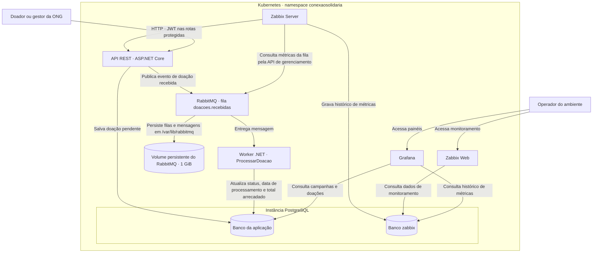

migration do banco:
é executada automaticamente ao iniciar a API

criar os containers e volumes docker:
executar comando abaixo na pasta raíz do projeto
docker compose up -d --wait

se precisar recriar:
- excluir o grupo 'conexaosolidaria' dos containers.
- excluir todos volumes com nome 'conexaosolidaria'

## Dados iniciais do banco

Ao criar o banco, a migration inicial cadastra a **Campanha Escola Pública**, com a descrição “Campanha Arrecadação Fundos para Escola Pública”. A campanha começa em 01/11/2026 e termina em 01/12/2026. Ela é criada com status **Ativa** (`1`), meta de R$ 50.000,00 e total arrecadado de R$ 0,00.

A migration também cadastra usuarios:
**João da Silva** com o perfil **Doador** (`1`), e-mail `joao@email.com`, senha `1234`

**Administrador** perfil **GestorONG** (`2`), e-mail `admin@admin.com`, senha inicial `1234`

rabbit-MQ:
url: http://localhost:15672/
Usuário: conexaosolidaria
Senha: conexaosolidaria-local

Api rodando em http://localhost:5033/swagger/index.html

Grafana rodando em http://127.0.0.1:3000
Usuário: admin
Senha: 1234

## Arquitetura do Conexão Solidária

