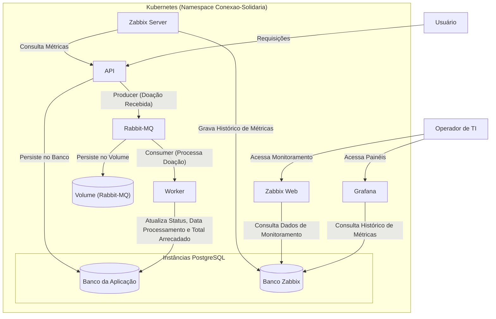

## Resumo

O Conexão Solidária é uma plataforma para ONGs gerenciarem campanhas de arrecadação e para doadores acompanharem campanhas e registrarem doações. A API em .NET registra cada doação no PostgreSQL e publica uma mensagem no RabbitMQ. Um worker processa a mensagem de forma assíncrona e atualiza o valor total arrecadado da campanha.

A solução usa autenticação JWT com perfis de gestor de ONG e doador. Pode ser executada com Docker Compose ou Kubernetes e conta com Zabbix e Grafana para monitorar a API e acompanhar as doações.

## Arquitetura

Segue abaixo desenho da arquitetura da solução.



## Bancos de Dados

A solução utiliza uma única instância do PostgreSQL com dois bancos. O banco `conexaosolidaria` armazena usuários, campanhas e doações e é compartilhado pela API e pelo Worker. Assim, o Worker consegue marcar a doação como processada e atualizar o total arrecadado da campanha na mesma transação, mantendo os dois registros consistentes.

O banco `zabbix` armazena as configurações e o histórico das métricas de monitoramento. A separação mantém os dados operacionais da aplicação independentes dos dados de monitoramento, enquanto o uso de uma única instância simplifica a implantação.

Migration do Banco: A API executa a migration automaticamente durante a inicialização.

## Executando a aplicação via Docker

O Docker Compose cria os contêineres e volumes definidos no `docker-compose.yaml`, inicia os serviços em segundo plano e aguarda até que estejam em execução.

Abra um terminal na raiz do projeto e execute o comando abaixo.

```bash
docker compose up -d --wait
```

### Acesso aos serviços

| Serviço | Endereço | Usuário | Senha |
| --- | --- | --- | --- |
| RabbitMQ | [localhost:15672](http://localhost:15672/) | conexaosolidaria | conexaosolidaria-local |
| API | [localhost:5033/swagger](http://localhost:5033/swagger/index.html) | — | — |
| Grafana | [127.0.0.1:3000](http://127.0.0.1:3000) | admin | 1234 |

### Recriar o ambiente Docker

Se precisar recriar o ambiente do zero, siga os passos abaixo no Docker Desktop.

1. Na seção **Containers**, exclua o grupo `conexaosolidaria`.
2. Na seção **Volumes**, exclua todos os volumes cujo nome começa com `conexaosolidaria`.
3. Na raiz do projeto, execute `docker compose up -d --wait` para recriar o ambiente.

## Executando a solução via Kubernetes

### Implantação

1. Habilite o Kubernetes no Docker Desktop.

2. Crie as imagens da API e do Worker executando os comandos abaixo.

```powershell
docker build -f Api/Dockerfile -t conexaosolidaria-api:local .
```

```powershell
docker build -f Worker/Dockerfile -t conexaosolidaria-worker:local .
```

3. Execute o comando abaixo para criar os recursos no cluster Kubernetes.

```powershell
kubectl --context docker-desktop apply -k k8s
```

### Acessando os Serviços

Execute cada port-forward em um terminal e mantenha-o aberto enquanto usar a interface.

| Interface | Comando | Endereço |
| --- | --- | --- |
| API | `kubectl --context docker-desktop -n conexaosolidaria port-forward svc/api 8080:8080` | http://localhost:8080/swagger |
| Grafana | `kubectl --context docker-desktop -n conexaosolidaria port-forward svc/grafana 3000:3000` | http://localhost:3000 |
| Zabbix | `kubectl --context docker-desktop -n conexaosolidaria port-forward svc/zabbix-web 8081:8080` | http://localhost:8081 |
| RabbitMQ | `kubectl --context docker-desktop -n conexaosolidaria port-forward svc/rabbitmq 15672:15672` | http://localhost:15672 |

## Testes

Para visualizar a mensagem da doação no Rabbit-MQ, pause o worker via comando abaixo. Depois reinicie ele.

Pausar o worker:
```powershell
kubectl --context docker-desktop -n conexaosolidaria scale deployment/worker --replicas=0
```

Reiniciar o worker:
```powershell
kubectl --context docker-desktop -n conexaosolidaria scale deployment/worker --replicas=1
```

### Recriar Kubernetes

Caso a solução já tenha sido criada no Kubernetes, e deseja-se excluir todo o namespace, execute o comando abaixo.

```powershell
kubectl --context docker-desktop delete namespace conexaosolidaria
```

## Dados Iniciais

Ao iniciar a API, ela executa automaticamente a migration do banco e cria os seguintes dados iniciais.

### Campanha

| Campo | Valor |
| --- | --- |
| Título | Campanha Escola Pública |
| Descrição | Campanha Arrecadação Fundos para Escola Pública |
| Data de início | 01/11/2026 |
| Data de término | 01/06/2027 |
| Status | Ativa |
| Meta financeira | R$ 50.000,00 |
| Total arrecadado inicial | R$ 0,00 |

### Usuários iniciais

| Nome | Perfil | E-mail | Senha |
| --- | --- | --- | --- |
| João da Silva | Doador | joao@email.com | 1234 |
| Administrador | GestorONG | admin@admin.com | 1234 |


## Rodar a aplicação em modo desenvolvedor

Para rodar a aplicação para fins de depuração, execute o comando abaixo na pasta raíz do projeto, que ele criará os serviços necessários (banco de dados e Rabbit-Mq).

```bash
docker compose up -d --wait
```

Abra a aplicação pelo Visual Studio, marque o projeto API como 'Project StartUp' e rode.

Para executar o worker, marque o projeto Worker como 'Project StartUp' e rode. Ele consumirá as filas automaticamente.